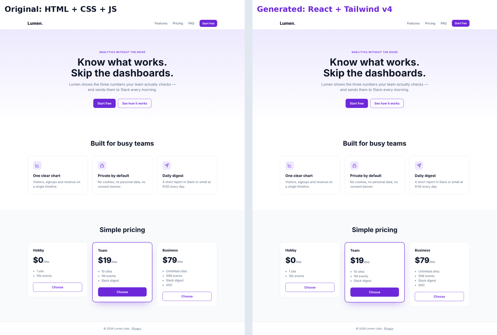

# html-to-react

A [Claude Code](https://claude.com/claude-code) skill that turns static markup (HTML + CSS or HTML + Tailwind) into clean React / Next.js components while spending very few tokens.



<sub>Left: the original HTML + CSS + JS. Right: React + Tailwind v4 produced with the skill. Screenshots differ by 0.2%.</sub>

## Idea

The usual approach has the model read the whole page and retype it as JSX. It pays for every byte twice, loses chunks on long files, and drags junk into React: wrapper divs, dead classes, scripts.

Here the work is split:

| Scripts (0 tokens) | Model |
|---|---|
| clean the HTML, convert CSS to Tailwind through a real cascade, turn repeated blocks into data + `.map()`, write the files, copy images, verify the result | reads a short outline of the page, decides component boundaries and names, rewrites the page's JS as React state |

## What it looks like

The full example is in [`examples/landing`](examples/landing): input → what the model sees → the result.

**1. `analyze`** — instead of 1.3k tokens of HTML the model reads a ~400-token outline ([outline.txt](examples/landing/h2r/outline.txt)):

```
n21 section#features.features
  n25 div.feature-card ×3 list{icon, featureTitle, featureText}
n37 section#pricing.pricing
  n41 div.plan ×3 list{featured, name, price, plans[], href}
```

**2. Plan** — the model only writes names and boundaries ([plan.json](examples/landing/h2r/plan.json)):

```json
"components": { "n1": "Header", "n11": "Hero", "n21": "Features", "n37": "Pricing", "n41": "PlanCard" },
"lists": { "n41": { "name": "plans", "fields": { "plans": "perks" } } },
"icons": { "i1": "lucide:ChartLine", "i2": "lucide:Lock", "i3": "lucide:Send" },
"client": ["Header"]
```

**3. `generate`** — writes the components. Repeated blocks become data, and `.plan.featured` becomes a typed prop ([output](examples/landing/output/components/landing)):

```tsx
type PlanCardProps = {
    featured?: boolean;
    name: string;
    price: ReactNode;
    perks: string[];
    href: string;
};
```

**4. Behavior and checks** — the model rebuilds the mobile menu with `useState` at the `TODO(h2r)` markers. `check` runs tsc and eslint, `visual-diff` compares screenshots of the original and the React version.

## Install

Requires Claude Code and Node 18+.

**As a plugin (recommended)** — in Claude Code:

```
/plugin marketplace add natankatsif/html-to-react-skill
/plugin install html-to-react@html-to-react-skill
```

The scripts install their npm dependencies on first use.

**With the skills CLI** ([skills.sh](https://skills.sh/p/lQQNepREX60TO6IY)) — from your project folder:

```bash
npx skills add https://skills.sh/p/lQQNepREX60TO6IY
```

**Manually** — copy the skill into a project (or `~/.claude/skills/` for all projects):

```bash
git clone https://github.com/natankatsif/html-to-react-skill
cp -r html-to-react-skill/skills/html-to-react <project>/.claude/skills/
```

## Usage

Just ask Claude Code: "convert `landing/index.html` into components". The skill triggers on its own (or call it as `/html-to-react:html-to-react` when installed as a plugin, `/html-to-react` when copied).

The scripts can also be run directly:

```bash
H="node <skill-dir>/scripts/h2r.mjs"
$H analyze landing/index.html --project .        # -> .h2r/<slug>/outline.txt, plan.json
$H generate .h2r/<slug>/plan.json                 # -> components, page, images
$H check .h2r/<slug>/plan.json --tsc --lint
$H visual-diff landing/index.html http://localhost:3000/<route>
```

`.h2r/` is a scratch folder; add it to `.gitignore`.

## Test results

| page | input | model reads | screenshot diff 1280 / 390 px |
|---|---|---|---|
| [example above](examples/landing) (HTML + CSS + JS) | ≈1.3k tokens | ≈0.5k | 0.22% / 0.95% |
| portfolio: HTML + 30 KB CSS + JS → Tailwind | ≈17k | ≈2.9k | 0.09% / 0.00% |
| Tailwind v2 landing → v4 | ≈19k | ≈1.1k | 0.01% / — ¹ |
| forms, tables, `pre`, SVG, entities | ≈1.2k | ≈0.5k | 0.02% / 0.05% |

`tsc` and `eslint` pass in every case. ¹ The template is missing an image at mobile width, so the comparison isn't fair.

## Features

- Next.js (app router) and React + Vite, TypeScript and JS. Adapts to the project: `@/` alias, indentation, Tailwind version.
- Two styling modes: `tailwind` (CSS converted to utilities, classes validated against the project's real Tailwind) and `css` (original classes + purged CSS scoped to the page).
- Handles Tailwind v4 traps: Preflight wiping browser defaults, arbitrary breakpoints sorting before `lg:`, cascade layers. Old Tailwind v1–v3 classes are renamed for v4.
- Inline SVGs become icon components or lucide icons; icon fonts (Font Awesome, Ionicons) map to lucide.

## Limitations

- Behavior (JS) is rewritten by the model. The scripts only show what the old code did and where.
- Bootstrap and similar frameworks are not converted to Tailwind — that would be a redesign.
- For snippets under ~150 lines the skill doesn't pay off; it describes a manual mode for those.

## Structure

```
.claude-plugin/         plugin + marketplace manifests
skills/html-to-react/   the skill: SKILL.md, references/, scripts/
examples/landing/       input, outline/plan, generated code, comparison screenshot
docs/research.md        research notes (in Russian): prior art, pitfalls, sources
```

## License

MIT
